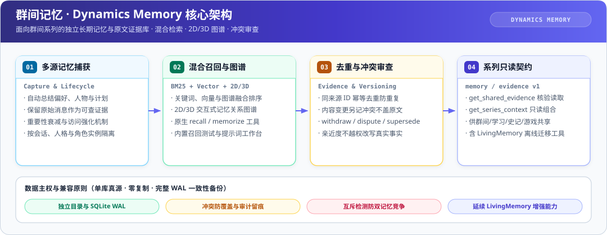

<div align="center">


# 群间记忆 · Dynamics Memory

**群间系列独立长期记忆与原文证据库：混合召回、2D/3D 记忆图谱、幂等去重与来源冲突审查。**


[](LICENSE)

[核心能力](#核心能力) · [系列联动](#与群间系列的联动) · [安装与迁移](#安装与迁移) · [群间系列生态](#群间系列生态) · [文档与许可](#进阶文档与许可)

</div>

---



## 核心能力

- **完整记忆生命周期与混合召回**：自动沉淀对话中的偏好、人物关系、计划与共同经历，结合 BM25 + 向量 + 知识图谱进行混合检索、重要性衰减与访问强化，保留 `recall_long_term_memory` 与 `memorize_long_term_memory` 原生工具。
- **原文证据与来源冲突审查**：每条重要记忆均可追溯原始消息来源。同一会话、人格、角色实例与来源 ID 重复写入保持幂等；若内容发生变化则保留原记录并登记冲突，通过版本校验与 `correct_insight`（withdraw / dispute / supersede）流程审慎处理，绝不静默覆盖原文。
- **2D/3D 交互式记忆图谱与控制台**：提供 2D/3D 记忆图谱浏览、节点聚焦、记忆编辑、召回测试、提示词配置及「系列接入与来源冲突」审查面板，统一适配群间系列日夜视觉风格。

## 与群间系列的联动

- **单库真源，只读共享**：声明 `memory` 与 `evidence` v1 能力协议，通过 `get_shared_evidence` 与 `get_series_context` 向群间、群间学习、群间游戏、群间史记提供经核验的只读证据视图，不落地复制其他插件数据库。
- **明确职责边界**：群间记忆只存真实对话与活动经历；角色虚构生活归属群间世界，审查后的表达策略归属群间学习，三者严格隔离。

## 安装与迁移

1. 在 AstrBot（`>=4.29.4,<5`）安装本插件与配套 **群间 · Chat Dynamics**。新装默认关闭「接入聊天与记忆记录」，避免与已有记忆插件产生双重采集。
2. 如需从原 LivingMemory 迁入，先停用源插件与本插件，使用内置一致性迁移工具（基于只读 SQLite Backup API，完整包含已提交 WAL）预览并导入：

```bash
python migration.py --source /AstrBot/data/plugin_data/astrbot_plugin_livingmemory --config /AstrBot/data/config/astrbot_plugin_livingmemory_config.json
python migration.py --source /AstrBot/data/plugin_data/astrbot_plugin_livingmemory --config /AstrBot/data/config/astrbot_plugin_livingmemory_config.json --destination /AstrBot/data/plugin_data/astrbot_plugin_dynamics_memory --apply-fingerprint <预览指纹> --offline
```

3. 停用原 LivingMemory，应用配置并开启接入后重载。保留 `/lmem` 管理命令与独立数据目录 `data/plugin_data/astrbot_plugin_dynamics_memory/`。

---

## 群间系列生态

| 插件 | 仓库与标识 | 核心定位 |
| --- | --- | --- |
| **群间 · Chat Dynamics** | [`astrbot_plugin_chat_dynamics`](https://github.com/ysyhlly/astrbot_plugin_chat_dynamics) | 核心对话调度层：碎发聚合、话题路由、参与决策与节奏交付 |
| **群间世界 · Dynamics World** | [`astrbot_plugin_dynamics_world`](https://github.com/ysyhlly/astrbot_plugin_dynamics_world) | 角色卡、世界书、双地图天气、持续生活与 3D 实况小屋 |
| **群间记忆 · Dynamics Memory**（当前） | [`astrbot_plugin_dynamics_memory`](https://github.com/ysyhlly/astrbot_plugin_dynamics_memory) | 长期记忆、混合召回、2D/3D 图谱与原文证据冲突审查 |
| **群间学习 · Dynamics Learning** | [`astrbot_plugin_dynamics_learning`](https://github.com/ysyhlly/astrbot_plugin_dynamics_learning) | 固定性格红线下的成员资料、黑话好感与可回滚审查学习 |
| **群间见闻 · Dynamics Horizons** | [`astrbot_plugin_dynamics_horizons`](https://github.com/ysyhlly/astrbot_plugin_dynamics_horizons) | 角色隔离外部信息源与书架、自主精读与分群待讨论话题 |
| **群间游戏 · Dynamics Games** | [`astrbot_plugin_dynamics_games`](https://github.com/ysyhlly/astrbot_plugin_dynamics_games) | 共读/约局/接龙/挑战/共创协作与四大群聊娱乐引擎 |
| **群间史记 · Dynamics Chronicle** | [`astrbot_plugin_group_chronicle`](https://github.com/ysyhlly/astrbot_plugin_group_chronicle) | 原文依据的长期群史卷册、人物传记与群文化梗沿革 |
| **群间视觉 · Visual Media** | [`astrbot_plugin_visual_media`](https://github.com/ysyhlly/astrbot_plugin_visual_media) | 表情收集检索、多模态生图改图与角色视觉形象管理 |

---

## 进阶文档与许可

- [发布说明](RELEASE_NOTES.md) · [更新日志](CHANGELOG.md) · [架构与接口说明](docs/architecture.md) · [证据视图协议](docs/evidence-view.md)
- 交流与反馈：项目反馈群兼聊天群 QQ `203363132`
- 基线源自 `lxfight` 的 LivingMemory 项目，完整署名与变更见 [NOTICE.md](NOTICE.md)；原项目说明见 [原中文](README_LIVINGMEMORY.md)、[English](README_en.md)、[Русский](README_ru.md)。本项目遵循 [AGPL-3.0 License](LICENSE)。
